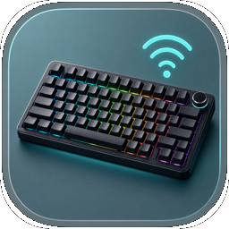
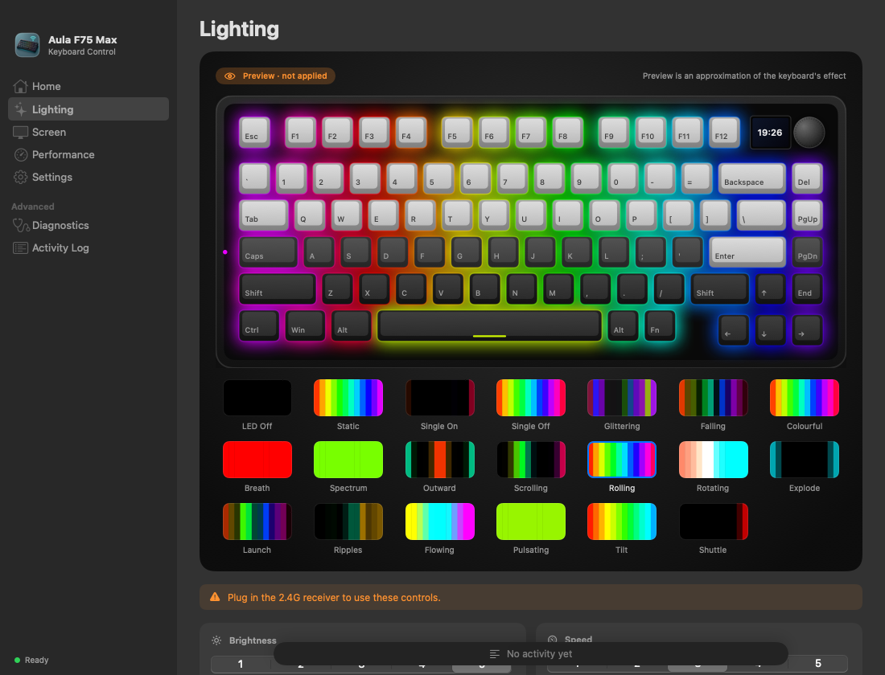
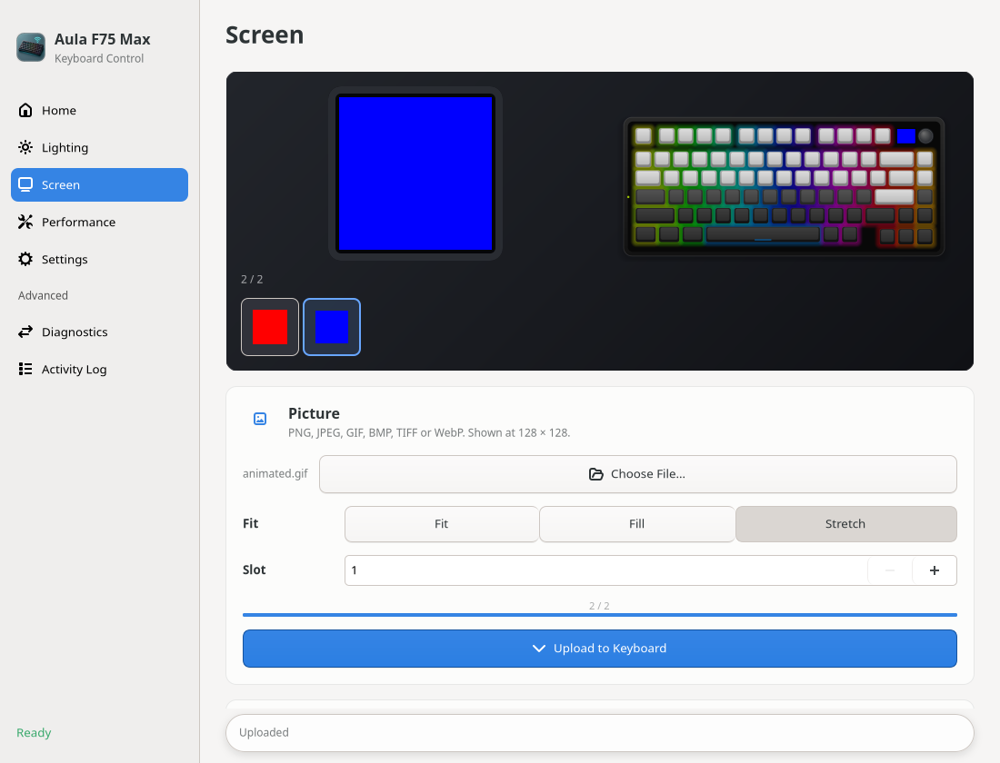
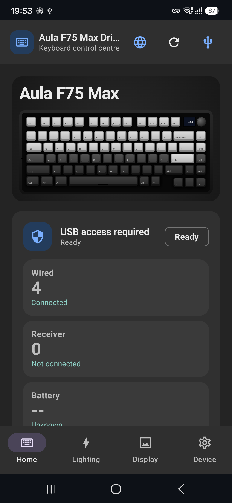

# Aula F75 Max Driver

<p align="center">
  
</p>

Configure your Epomaker x Aula F75 Max keyboard on macOS, Linux, and Android.

**[Download the latest version](https://github.com/VitalyArt/Aula-F75-Max-Driver/releases/latest)**

## What you can do

- Customize RGB lighting, preview effects, and save your favorite profiles.
- Put an image or animated GIF on the keyboard display.
- Sync the keyboard clock with your device's local time.
- Check battery level and adjust performance, sleep, and Game Mode settings.
- Get low-battery notifications on macOS and Linux.
- Open **Keyboard guide** for offline Fn shortcuts, pairing, and Windows/Mac function-key reference.

## Download and install

Open the [download page](https://github.com/VitalyArt/Aula-F75-Max-Driver/releases/latest) and choose the file for your device. You do not need developer tools to install the app.

| Platform | Requirements | Download |
| --- | --- | --- |
| macOS | macOS 14 or newer, Apple Silicon Mac | `.dmg` |
| Linux | Debian / Ubuntu, package matching your computer's architecture | `.deb` |
| Android | Android 9 or newer, USB OTG support | `.apk` |

### macOS

1. Open the downloaded DMG and drag **Aula F75 Max Driver** into **Applications**.
2. Open the app from Applications.
3. If macOS blocks it, dismiss the warning, open **System Settings → Privacy & Security**, and click **Open Anyway** for the app. Confirm to open it.

### Linux

Download the DEB matching your computer's architecture. Open a terminal in its download folder and run the following, keeping only the Aula DEB you want to install in that folder:

```sh
sudo apt update
sudo apt install ./AulaF75MaxDriver-v*_*.deb
```

Unplug and reconnect the keyboard and receiver after installation, then open **Aula F75 Max Driver** from your applications menu. Run the app normally, without `sudo`.

The DEB also fixes F1–F12 being treated as media keys by setting `hid_apple fnmode=2` immediately when the module is loaded and saving it in `/etc/modprobe.d/aula-f75-max.conf` for future boots. Installation and upgrades refresh initramfs when `update-initramfs` is available. This system-wide setting affects all keyboards handled by `hid_apple`.

To disable the persistent fix, comment out `options hid_apple fnmode=2` in that file, run `sudo update-initramfs -u`, and reboot. DEB upgrades preserve your configuration edits, but apply `fnmode=2` to the current session again; reboot to restore your chosen boot setting. Purging the package removes its configuration and refreshes initramfs; it does not change the current session's `fnmode`.

### Android

1. Open the downloaded APK. If prompted, allow your browser or file manager to install apps, then complete installation.
2. Connect the keyboard or receiver using a USB OTG adapter.
3. Open the app, tap **Grant USB access**, and approve the system prompt.

## Connect your keyboard

Choose the connection for the task you want to perform:

| Connection | Keyboard mode | Available functions |
| --- | --- | --- |
| USB data cable | Wired / USB | Upload images and GIFs, sync the clock, factory reset |
| 2.4G USB receiver | 2.4G wireless | Read battery level, change RGB lighting, performance, sleep, and Game Mode settings |

On Android, connect either accessory through OTG and grant USB access. Open **Home** to check the connection status.

- **Lighting:** choose an effect, adjust it, then click **Apply to Keyboard** on desktop or **Apply** on Android. Save profiles to reuse your settings. Lighting previews and saved profiles also work without a connected receiver.
- **Screen:** choose an image or GIF, select how it fits the display, and upload it over USB. On desktop you can preview the animation; Android previews the first GIF frame.
- **Clock:** connect the keyboard by USB and use the clock sync action.

## Screenshots

### macOS



### Linux



### Android



## If something is not working

**Keyboard not detected?** Check the keyboard mode and use a USB data cable. Reconnect the keyboard or receiver, and try a direct USB port instead of a hub. On Linux, reconnect both accessories after installing the DEB.

**macOS detects the keyboard but commands fail?** Allow the app in **System Settings → Privacy & Security → Input Monitoring**, then restart it. This permission is separate from allowing the app's first launch.

**Android cannot access the keyboard?** Confirm your device supports USB OTG, tap **Grant USB access**, and approve the prompt.

**Battery is unavailable, or lighting settings will not apply?** These functions require the 2.4G receiver and the keyboard in 2.4G mode. A wired connection alone does not provide battery readings.

**Image upload or clock sync fails?** Use a USB data cable with the keyboard in wired mode. For uploads, try a small still image first.

Still stuck? [Report a problem](https://github.com/VitalyArt/Aula-F75-Max-Driver/issues/new?template=bug_report.yml) with your operating system, app version, connection type, and the step that failed. The app's **Diagnostics** and **Activity Log** can help identify the problem.

## For developers

See the [development guide](docs/DEVELOPMENT.md) for building, testing, architecture, and release instructions.

## License

See [LICENSE](LICENSE).
